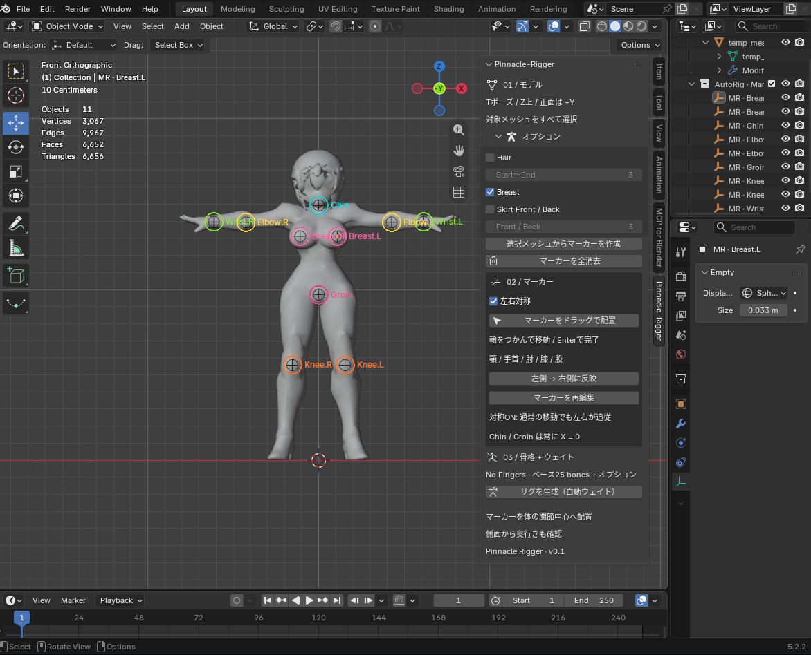

# Pinnacle Rigger · Local Auto Rig



選択中のメッシュからマーカーを調整して，人型の骨格とウェイトを生成するBlenderアドオンです。
**Mixamoのあれ**をBlenderにもってきた感じです。

## インストール

1. Blender の「編集 → プリファレンス → アドオン → ディスクからインストール」で `dist/pinnacle_rigger-0.1.0.zip` を選択します。
2. `Pinnacle Rigger` を有効にします。
3. 3Dビューで `N` キーを押し，**Pinnacle-Rigger** タブを開きます。

Blender 4.2以上を対象にしています。実機テストはBlender 5.2.2 LTS / Linuxで実施しました。

## 使い方

1. Blender標準のAppendやインポートを使い，対象メッシュをシーンに用意して選択します。キャラクター以外のメッシュは選択から外してください。
2. オプションを必要に応じて選び，**選択メッシュからマーカーを作成**を押します。
3. **マーカーをドラッグで配置**を押し，色付きの輪をつかんで自由な順番で移動します。Enterで完了します。Esc / 右クリックは移動を取り消します。
4. 体の中心をワールドX=0に合わせます。正面では奥行きを保ち，側面ビューでは奥行きも調整できます。
5. **リグを生成**を押します。生成後はマーカーと元メッシュを削除し，リグとスキン済みメッシュを元のシーン階層に置きます。保存は通常のBlender保存（`Ctrl+S`）を使います。

マーカー作成・リグ生成はBlenderのUndoに対応します。生成前なら「マーカーを全消去」でマーカーを消し，オプションを選び直せます。

対象の選択，マーカー作成，リグ生成はBlenderのUndoに対応しています。読み込んだオブジェクトのカスタムプロパティ `mr_*` は，このアドオンのセッション情報として予約しています。

## v1.0 の範囲

- **指なし25ボーン**。`mixamorig:Hips`，`LeftArm` 等の命名を使います。指の41/49/65ボーン，IK，アニメーション一覧，リターゲットは未実装です。
- 顎・手首・肘・膝・股の8マーカー。肩・背骨・足首・足先は体格比率から推定します。初期位置はヒューリスティックであり，学習済みの人体認識ではありません。
- BlenderのBone Heatによる自動ウェイトを使用します。未割り当て頂点には近傍3ボーンへの距離ウェイトを補完し，頂点数を結果に明示します。補完が多いモデルは必ずポーズで検査してください。
- 複数メッシュ，ワールド変換済みメッシュ，マテリアルに対応します。**生成側は現在のモディファイアとポーズをメッシュに焼き込むため，シェイプキーや編集可能なモディファイアは引き継ぎません。
- 服，帽子，指などの局所変形はモデルに依存します。Mixamoのウェイト，ボーン軸，リターゲット互換性を再現するものではありません。指なしでも手の形状自体は残ります。
- モデルはZ上向き，足元が下，正面−Yに整えてください。横倒し，Aポーズ，腕を下げたポーズ，四足，極端な非人型には対応していません。

## 検証

- `tests/blender_smoke.py`: ウェイト，腕の変形，.blend入出力の検証。
- `tests/blender_native.py`: .blend入力，複数メッシュ，変換，ウェイト補完の検証。
- `tests/blender_drag.py`: 任意順のドラッグ，左右追従，取り消し，側面の奥行き移動の検証。
- `tests/blender_install.py`: ZIPの有効化・無効化とBlender登録時の初期化を検証。

FBX / .blend を使う検証には，`PINNACLE_RIGGER_REFERENCE` で指定したフォルダに `noufu.fbx`，`T-Pose.fbx`，`noufu_R04.blend` を置いてください。検証成果物は一時ディレクトリに保存します。人物モデルや生成済みファイルはリポジトリに含めていません。

## ソース

`pinnacle_rigger/__init__.py` にUIとオペレーター，`pinnacle_rigger/core.py` にマーカー・骨格・ウェイト処理を分離しています。ZIPは次で再生成できます。

```bash
python3 build.py
```

## オプションとマーカーのリセット

オプションは折りたたみ式です。マーカーを作成する前にHair，Breast，Skirt Front / Backを選び，選択に応じてマーカーとボーンを追加します。髪とスカートはそれぞれ3〜6本で分割できます。Front／Backは股の中心から対応するマーカーまでのチェーンになります。追加ボーンは `mixamorig:Hairs`，`mixamorig:Breasts`，`mixamorig:Skirts` の親の下にまとめ，親は非変形ボーンとしてワールドX=0に配置します。

オプションを選び忘れた場合は「マーカーを全消去」を押し，チェックを変更してマーカーを作り直します。基本マーカー8個に加えてオプション用マーカーがあっても生成できます。各オプションは対応するマーカーが揃っているか個別に確認します。この操作は現在のセッションのマーカーを削除し，元のメッシュを再選択します。
